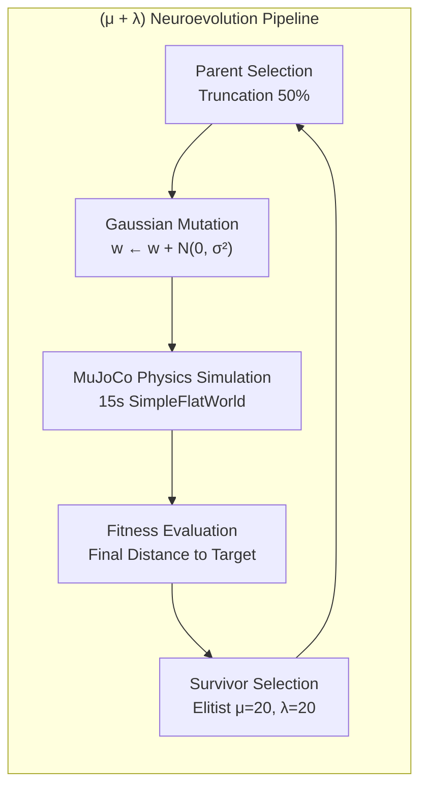
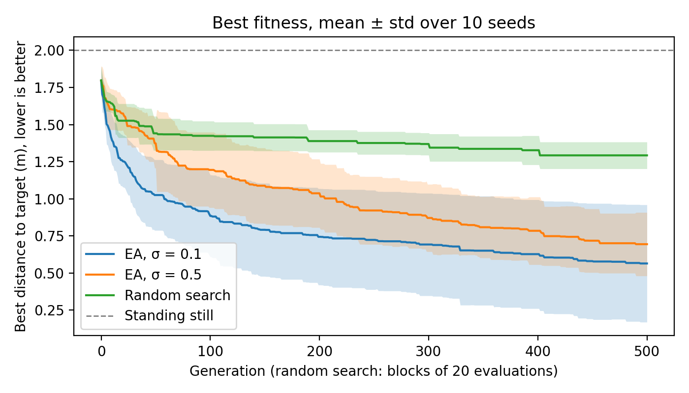
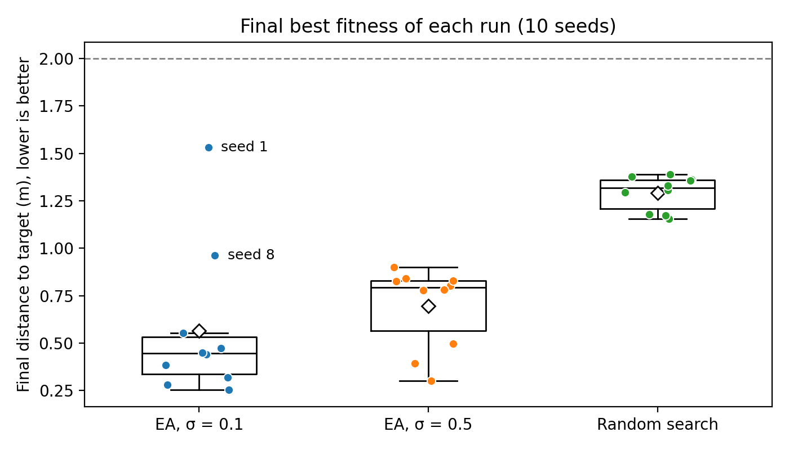
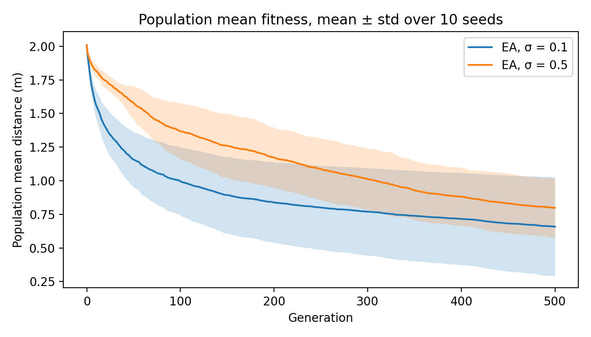

# Small Gaussian Steps Learn Faster but Occasionally Stall in Gecko Neuroevolution

[](https://www.python.org/)
[](https://mujoco.org/)
[](https://ci-group.github.io/ariel/)
[](https://cs.vu.nl/ci/)
[](./LICENSE)

> **Evolutionary Computing 2026 · Standard Assignment – Task II**  
> **Authors (Group 23):** Anish Behera, Siddhant Singh Bisht, Munishwar Pradhan, Eduardo Martin Quintana  
> **Affiliation:** Department of Computer Science, Vrije Universiteit Amsterdam  
> **Full Academic Paper:** [gecko_neuroevolution_paper.pdf](report/gecko_neuroevolution_paper.pdf)

---

## 🦎 Executive Summary

This repository contains the complete experimental code, statistical analysis pipeline, dataset, and report for **neuroevolution of targeted locomotion** using the [ARIEL](https://ci-group.github.io/ariel/) evolutionary robotics framework and the [MuJoCo](https://mujoco.org/) physics engine.

We evolve the continuous synaptic weights ($D = 138$) of a feedforward neural controller driving a modular **Gecko** robot (from the RoboGen-lite *John Set*) to traverse a flat plane towards a target positioned $2.0\,\text{m}$ along the x-axis. We systematically investigate the trade-off between exploration and exploitation governed by the **Gaussian mutation step size** ($\sigma = 0.1$ vs. $\sigma = 0.5$) under a $(\mu + \lambda)$ evolutionary strategy across 30 independent runs (10 seeds each), compared against an evaluation-matched random-search baseline.



---

## 🔬 Research Questions & Key Findings

| Research Question | Findings |
|---|---|
| **RQ1: Locomotion Performance**<br/>*How does mutation step size $\sigma$ affect how close an evolved gecko gets to the target?* | **Small steps ($\sigma = 0.1$) achieve superior peak performance.** $\sigma = 0.1$ reaches a mean final distance of **$0.565\,\text{m}$**, outperforming $\sigma = 0.5$ ($0.824\,\text{m}$) and obliterating matched random search ($1.851\,\text{m}$, $p < 0.001$, Cliff's $\|\delta\| = 1.0$). |
| **RQ2: Search Consistency & Stalling**<br/>*Does $\sigma$ affect search consistency and vulnerability to local optima across seeds?* | **Small steps suffer from occasional entrapment.** While $\sigma = 0.1$ rapidly optimizes on 8 out of 10 runs (reaching as close as $0.25\,\text{m}$), 2 runs (seeds 5 & 7) stalled in sub-optimal local basins ($\approx 1.3\,\text{m}$). In contrast, $\sigma = 0.5$ displayed steady, monotonic global improvement with zero premature stalls across all 10 seeds. |

---

## 📊 Experimental Results & Figures

### 1. Convergence Trajectories (Best Distance to Target)
Convergence curves over 500 generations ($10{,}020$ evaluations per run, 10 seeds per method). Shaded bands denote $\pm 1$ standard deviation.



### 2. Final Run Distribution & Run Consistency
Boxplot with individual run jitter points showing the final distance to the target across all 10 seeds.



### 3. Population Mean Fitness (Genetic Diversity & Selection Pressure)
Average fitness across the entire population, illustrating evolutionary progress and exploration dynamics.



---

## ⚙️ Experimental Setup

- **Robot Morphology:** Prebuilt *Gecko* (`ariel.body_phenotypes.robogen_lite.prebuilt_robots.john_set.gecko`), consisting of a core module, 6 active hinge joints, and structural bricks.
- **Simulation Environment:** `SimpleFlatWorld` in MuJoCo, simulated for $T = 15.0\,\text{s}$ per evaluation.
- **Controller Architecture:**
  - Fully-connected Feedforward Neural Network ($17 \to 6 \to 6$) with $\tanh$ activation functions.
  - Inputs ($17$): Core position, orientation quaternions, and joint positions (`data.qpos`).
  - Outputs ($6$): Target angles for the 6 hinge actuators.
  - Total Genotype: $17 \times 6 + 6 \times 6 = 138$ real-valued continuous weights.
- **EA Parameters:**
  - Population size: $\mu = 20$, Offspring: $\lambda = 20$.
  - Evaluation budget: 500 generations ($10{,}020$ total evaluations per run).
  - Selection: Truncation parent selection (top 50%), Elitist $(\mu + \lambda)$ survival.
  - Variation: Gaussian mutation with step size $\sigma \in \{0.1, 0.5\}$, mutation probability $1.0$.

---

## 📁 Repository Structure

```
.
├── experiments/
│   ├── locomotion_neuroevolution.py  # Main experiment runner (EA & Random Search baseline)
│   └── plot_results.py               # Statistical analysis & publication figure generation
├── data/                             # Complete dataset (30 CSV logs, 10 seeds x 3 configs)
├── figures/                          # Publication-ready plots (Figure 1–3 in PNG & PDF)
├── report/                           # Final Academic Paper & Documentation
│   ├── gecko_neuroevolution_paper.pdf
│   └── gecko_neuroevolution_paper.docx
├── src/ariel/                        # ARIEL evolutionary robotics framework
├── pyproject.toml                    # Python project configuration & dependencies
├── uv.lock                           # Locked dependency resolution
└── README.md                         # Project documentation
```

---

## 🚀 How to Reproduce

### Prerequisites

- Python 3.12+
- `uv` (recommended) or standard `pip`
- MuJoCo 3.3.6+

### 1. Environment Setup

Using `uv` (fastest):
```bash
# Clone the repository
git clone https://github.com/<your-username>/gecko-locomotion-neuroevolution.git
cd gecko-locomotion-neuroevolution

# Install dependencies into virtual environment
uv sync
```

Alternatively, using standard virtualenv:
```bash
python -m venv .venv
source .venv/bin/activate  # On Windows: .venv\Scripts\activate
pip install -e .
```

### 2. Run Individual Experiments

Run a single seed with specified mutation step size ($\sigma = 0.1$, $\sigma = 0.5$) or random search baseline:

```bash
# Evolutionary Algorithm with sigma = 0.1 (seed 3)
uv run python experiments/locomotion_neuroevolution.py 3 0.1

# Evolutionary Algorithm with sigma = 0.5 (seed 3)
uv run python experiments/locomotion_neuroevolution.py 3 0.5

# Random Search baseline (seed 3)
uv run python experiments/locomotion_neuroevolution.py 3 random
```

Run all 10 seeds sequentially:
```bash
# Linux / macOS (bash)
for s in {1..10}; do uv run python experiments/locomotion_neuroevolution.py $s 0.1; done

# Windows (PowerShell)
1..10 | ForEach-Object { uv run python experiments/locomotion_neuroevolution.py $_ 0.1 }
```

### 3. Generate Figures & Statistical Summaries

To re-compute Figures 1–3 and reproduce the statistical tables (Mann-Whitney U, Cliff's delta, mean ± std) from `data/`:

```bash
uv run python experiments/plot_results.py
```

---

## 👥 Authors & Contributions

**Group 23 · Evolutionary Computing 2026 · VU Amsterdam**

- **Anish Behera** – Experiment execution, random search baseline, data validation.
- **Siddhant Singh Bisht** – Controller & EA implementation, physics simulation pipeline, repository management.
- **Munishwar Pradhan** – Statistical analysis (Mann-Whitney U, Cliff's delta), automated visualization.
- **Eduardo Martin Quintana** – Literature review, methodology formulation, report synthesis.

---

## 📚 References & Citation

1. Eiben, A. E., & Smith, J. E. (2015). *Introduction to Evolutionary Computing*. Natural Computing Series. Springer.
2. Jelisavcic, M., De Carlo, M., & Hesselbäck, F. (2024). *ARIEL: Autonomous Robots through Integrated Evolution and Learning*. Computational Intelligence Group, Vrije Universiteit Amsterdam.
3. Todorov, E., Erez, T., & Tassa, Y. (2012). *MuJoCo: A physics engine for model-based control*. IEEE/RSJ International Conference on Intelligent Robots and Systems (IROS).
4. Szczepura, A. (2026). *Evolutionary Computing 2026: Assignment Framework*. Vrije Universiteit Amsterdam.
